# NetStream

[](https://en.wikipedia.org/wiki/C%2B%2B17)
[](https://kernel.org)
[](https://cmake.org)
[]()

**NetStream** is a high-performance, asynchronous networking server and UDP media streaming library written in modern C++17 for Linux. It combines an event-driven, single-reactor edge-triggered TCP architecture with an RTP-inspired UDP media streamer equipped with bounded jitter buffering and cryptographic integrity verification.

---

## Table of Contents
1. [Project Overview](#1-project-overview)
2. [Features and Non-Goals](#2-features-and-non-goals)
3. [Architecture Overview](#3-architecture-overview)
4. [TCP Reactor & Event Loop Design](#4-tcp-reactor--event-loop-design)
5. [Thread Pool Architecture](#5-thread-pool-architecture)
6. [Connection Ownership & Concurrency Model](#6-connection-ownership--concurrency-model)
7. [TCP Framing Specification](#7-tcp-framing-specification)
8. [UDP Packet Format & Protocol](#8-udp-packet-format--protocol)
9. [Jitter Buffer Algorithm](#9-jitter-buffer-algorithm)
10. [Build and Installation](#10-build-and-installation)
11. [Running the Executables](#11-running-the-executables)
12. [Example TCP Echo Session](#12-example-tcp-echo-session)
13. [Example UDP File-Transfer Session](#13-example-udp-file-transfer-session)
14. [Automated Test Suite](#14-automated-test-suite)
15. [Sanitizers and Memory Checking](#15-sanitizers-and-memory-checking)
16. [Linux tc netem Impairment Simulation](#16-linux-tc-netem-impairment-simulation)
17. [Benchmark Methodology & Results](#17-benchmark-methodology--results)
18. [Engineering Tradeoffs](#18-engineering-tradeoffs)
19. [Feature Implementation Status](#19-feature-implementation-status)
20. [Limitations and Future Work](#20-limitations-and-future-work)

---

## 1. Project Overview

NetStream provides production-grade systems implementations of foundational POSIX network patterns:
- An **edge-triggered `epoll` reactor** handling thousands of concurrent connections with zero busy-waiting.
- A **bounded worker pool** with backpressure that offloads CPU tasks while keeping socket I/O strictly non-blocking.
- Safe asynchronous response delivery back to the reactor using `eventfd` and generation tokens to defeat descriptor reuse races.
- A **paced UDP file streamer** that packetizes arbitrary binary files and streams them without IP fragmentation.
- A **jitter buffer** that handles out-of-order packets, discards duplicates, detects late arrivals, and advances past missing packets upon playout deadlines.
- End-to-end file reconstruction verified via embedded SHA-256 checksumming.

---

## 2. Features and Non-Goals

### Features
- **Pure POSIX/Linux implementation**: No heavy external dependencies (Boost, libevent, or libuv).
- **Edge-triggered epoll (`EPOLLET`)**: Complete socket draining on accept, read, and write loops until `EAGAIN`/`EWOULDBLOCK`.
- **Bounded backpressure**: Thread pool rejects or blocks when task limits are reached, guarding against memory exhaustion.
- **Signal-safe lifecycle**: Handles `SIGINT`/`SIGTERM` synchronously using `signalfd`.
- **Descriptor lifecycle safety**: Generation tokens and 64-bit connection IDs prevent use-after-free and fd recycling collisions.
- **RTP-style UDP streaming**: Modular 32-bit sequence number arithmetic, media timestamping, microsecond pacing.
- **Deadline-aware jitter buffer**: Reorders packets within a bounded delay; expires missing datagrams upon deadline without stalling.
- **Comprehensive metrics**: Measures throughput (req/s, Mbps), p50/p90/p95/p99/max latency, packet loss, and jitter.

### Non-Goals
- Full RFC 3550 RTCP feedback and congestion control (NetStream focuses on educational streaming and deterministic testability).
- TLS / SSL encryption (intended to keep low-level networking primitives clean and observable via `tcpdump`/`wireshark`).
- Cross-platform abstraction layers (specifically tuned for Linux kernel APIs: `epoll`, `signalfd`, `eventfd`, `accept4`).

---

## 3. Architecture Overview

```mermaid
graph TD
    subgraph "TCP Server"
        Listen[Listening Socket: EPOLLET] -->|accept4 loop| Epoll[Reactor Event Loop: epoll_wait]
        ClientSock[Client Sockets: EPOLLET] -->|recv loop| Epoll
        Epoll -->|Frame Parsed| Submit[Submit Task]
        Submit --> BoundedQ[Bounded Task Queue]
        BoundedQ --> Workers[Worker Threads]
        Workers -->|WorkerResponse| CompQ[Completion Queue]
        CompQ -->|write 1| EventFd[eventfd Wakeup]
        EventFd --> Epoll
        Epoll -->|flush_output / EPOLLOUT| ClientSock
    end

    subgraph "UDP Streamer"
        SrcFile[Source File] --> Chunker[Paced File Chunker]
        Chunker --> TxSock[UDP Sender Socket]
        TxSock -->|Network Impairment: tc netem| RxSock[UDP Receiver Socket]
        RxSock --> JitterBuf[Bounded Jitter Buffer]
        JitterBuf -->|In-Order Playout| Reconstruct[File Reconstructor]
        Reconstruct --> DstFile[Reconstructed File]
    end
```



---

## 4. TCP Reactor & Event Loop Design

The server operates a **single-threaded epoll reactor**:
1. **Listening Socket Setup**:
   ```cpp
   socket(AF_INET, SOCK_STREAM | SOCK_NONBLOCK | SOCK_CLOEXEC, 0);
   setsockopt(..., SO_REUSEADDR, ...);
   epoll_ctl(..., EPOLL_CTL_ADD, listen_fd, EPOLLIN | EPOLLET);
   ```
2. **Edge-Triggered Accept Loop**:
   When `EPOLLIN` fires on the listener, `accept4()` is called repeatedly until it returns `EAGAIN` or `EWOULDBLOCK`. All incoming connections are assigned non-blocking and close-on-exec flags atomically.
3. **Edge-Triggered Read Loop**:
   When `EPOLLIN` fires on a client socket, `recv()` drains the kernel socket buffer in 8KB chunks until `EAGAIN`. Newly arrived bytes are appended to the connection's `FrameParser`.
4. **Dynamic Write Registration**:
   Connections maintain an output buffer. Responses are sent immediately via non-blocking `send(..., MSG_NOSIGNAL)`. If the socket buffer fills up:
   - Partial writes update `output_offset`.
   - `EPOLLOUT` is registered with `epoll_ctl(EPOLL_CTL_MOD)`.
   - Once the buffer is fully drained, `EPOLLOUT` is removed immediately to prevent 100% CPU spinning.

---

## 5. Thread Pool Architecture

The worker pool provides bounded, deterministic task execution:
- **Thread Count & Capacity**: Configurable (defaults: 4 threads, 1024 queue capacity).
- **Synchronization**: `std::mutex`, `std::condition_variable` (`cv_not_empty_`, `cv_not_full_`).
- **Full-Queue Policies**:
  - `FullQueuePolicy::Block`: Producer waits on `cv_not_full_` until queue space opens or shutdown occurs.
  - `FullQueuePolicy::Reject`: Producer receives immediate `false` backpressure notification.
- **Worker Exception Handling**: All tasks execute inside a `try/catch` wrapper, ensuring an unhandled exception in one request does not crash worker threads.
- **Graceful Drain**: `shutdown(drain=true)` stops new submissions, executes all queued work, and joins worker threads cleanly.

---

## 6. Connection Ownership & Concurrency Model

### Single-Owner Rule
The reactor thread exclusively owns all `Connection` objects, socket file descriptors, read buffers, and write buffers. Worker threads never hold references to `Connection` or invoke socket system calls.

### Response Completion & Token Safety
```
Worker Task Finished -> Push {conn_id, gen, payload} to CompletionQueue -> write(1) to eventfd
                                                                                |
                                                                                v
Reactor wakes on eventfd -> Match conn_id & gen -> Serialize -> Queue Output -> send()
```
- If a connection disconnects while its task is in the worker pool, the reactor removes `conn_id`. When the worker finishes, the response is discarded safely.
- If a socket file descriptor number is recycled by the kernel, the generation token mismatch causes the stale response to be discarded, eliminating cross-connection corruption.

---

## 7. TCP Framing Specification

NetStream uses a binary-safe 4-byte length prefix:
```
+--------------------------------+--------------------------------+
|  Payload Length (4 bytes, BE)  |    Payload Data (N bytes)      |
+--------------------------------+--------------------------------+
```
- **Byte Order**: Network byte order (Big Endian, via `htonl`/`ntohl`).
- **Arbitrary Data**: Supports embedded null bytes (`0x00`), binary media, JSON, or text.
- **Incremental Parser**: Preserves partial frames across reads and extracts multiple complete frames received in a single `recv()`.

---

## 8. UDP Packet Format & Protocol

Packets include a fixed 28-byte binary header followed by payload:
```
 0                   1                   2                   3
 0 1 2 3 4 5 6 7 8 9 0 1 2 3 4 5 6 7 8 9 0 1 2 3 4 5 6 7 8 9 0 1
+-+-+-+-+-+-+-+-+-+-+-+-+-+-+-+-+-+-+-+-+-+-+-+-+-+-+-+-+-+-+-+-+
|    Version    |  Payload Type |             Flags             |
+-+-+-+-+-+-+-+-+-+-+-+-+-+-+-+-+-+-+-+-+-+-+-+-+-+-+-+-+-+-+-+-+
|                           Stream ID                           |
+-+-+-+-+-+-+-+-+-+-+-+-+-+-+-+-+-+-+-+-+-+-+-+-+-+-+-+-+-+-+-+-+
|                        Sequence Number                        |
+-+-+-+-+-+-+-+-+-+-+-+-+-+-+-+-+-+-+-+-+-+-+-+-+-+-+-+-+-+-+-+-+
|                           Timestamp                           |
+-+-+-+-+-+-+-+-+-+-+-+-+-+-+-+-+-+-+-+-+-+-+-+-+-+-+-+-+-+-+-+-+
|                         Payload Length                        |
+-+-+-+-+-+-+-+-+-+-+-+-+-+-+-+-+-+-+-+-+-+-+-+-+-+-+-+-+-+-+-+-+
|                          File Offset                          |
|                           (64-bit)                            |
+-+-+-+-+-+-+-+-+-+-+-+-+-+-+-+-+-+-+-+-+-+-+-+-+-+-+-+-+-+-+-+-+
|                     Payload (up to 1400 B)                    |
+-+-+-+-+-+-+-+-+-+-+-+-+-+-+-+-+-+-+-+-+-+-+-+-+-+-+-+-+-+-+-+-+
```
- **Version**: `1`
- **Flags**: `FLAG_START_OF_STREAM` (`0x0001`), `FLAG_END_OF_STREAM` (`0x0002`).
- **File Offset**: 64-bit integer (`htobe64`), allowing non-linear reconstruction directly into output files.
- **Conservative Datagram Size**: Max chunk size 1400 bytes + 28 bytes header = 1428 bytes, strictly below 1500 MTU to eliminate IP fragmentation.

---

## 9. Jitter Buffer Algorithm

The `JitterBuffer` implements bounded, deadline-aware packet reordering:
1. **Sequence Arithmetic**: 32-bit modular ordering (`static_cast<int32_t>(a - b) < 0`).
2. **Buffering Delay**: Holds initial incoming packets for a configurable playout delay (e.g., 50ms) before releasing the first packet.
3. **Playout Loop**:
   - If `expected_seq` is in buffer: pops packet, increments `expected_seq++`, writes to disk.
   - If `expected_seq` is missing: waits until `now - earliest_arrival >= packet_timeout`.
   - Upon timeout: increments `packets_lost += gap`, advances `expected_seq` to lowest available sequence number, and resumes playout.
4. **Duplicate & Late Suppression**:
   - Duplicate sequences are dropped immediately.
   - Packets arriving with sequence number `< expected_seq` are recorded as late arrivals and dropped.

---

## 10. Build and Installation

### Prerequisites
- Linux OS (kernel $\ge 4.5$)
- GCC $\ge 9$ or Clang $\ge 10$ supporting C++17
- CMake $\ge 3.16$
- Make or Ninja
- `iproute2` (for `tc netem` impairment testing)

### Building the Project
```bash
# Clone and enter workspace
cd NetStream

# Create build directory
mkdir build && cd build

# Configure and compile with standard optimizations
cmake -DCMAKE_BUILD_TYPE=Release ..
make -j$(nproc)
```

---

## 11. Running the Executables

### 1. TCP Server
```bash
./build/netstream_server -a 0.0.0.0 -p 8080 -t 4 -q 1024
```
Options:
- `-a, --host <ip>`: Listening interface (default `0.0.0.0`)
- `-p, --port <port>`: Port number (default `8080`)
- `-t, --threads <n>`: Worker pool thread count (default `4`)
- `-q, --queue <cap>`: Queue capacity (default `1024`)
- `-m, --max-msg <bytes>`: Maximum message size in bytes (default `16777216`)
- `-v, --verbose`: Enable debug logging

### 2. TCP Client
```bash
./build/netstream_client -a 127.0.0.1 -p 8080 -c 10 -s 256
```

### 3. UDP File Receiver
```bash
./build/netstream_udp_receiver -o /tmp/received_file.bin -p 9000
```

### 4. UDP File Sender
```bash
./build/netstream_udp_sender -f /path/to/source.bin -a 127.0.0.1 -p 9000 -i 100
```

### 5. TCP Load Generator
```bash
./build/netstream_load_generator -a 127.0.0.1 -p 8080 -c 16 -r 250 -s 128 -o ./docs/bench_result
```

---

## 12. Example TCP Echo Session

Start the server:
```bash
./build/netstream_server -p 8080
```
Run client:
```bash
./build/netstream_client -p 8080 -c 3 -m "Hello NetStream"
```
Output:
```
[INFO ] Connecting to 127.0.0.1:8080...
[INFO ] Connected successfully.
[INFO ] Message 1/3 (17 bytes) echoed successfully in 0.61 ms [VALIDATED]
[INFO ] Message 2/3 (17 bytes) echoed successfully in 0.48 ms [VALIDATED]
[INFO ] Message 3/3 (17 bytes) echoed successfully in 0.52 ms [VALIDATED]
[INFO ] Finished. Verified: 3/3 messages.
```

---

## 13. Example UDP File-Transfer Session

Start receiver in terminal 1:
```bash
./build/netstream_udp_receiver -o /tmp/reconstructed.bin -p 9000
```
Stream file in terminal 2:
```bash
./build/netstream_udp_sender -f ./sample.bin -p 9000 -i 100
```
Output:
```
--- UdpSender Summary ---
File Size:   2097152 bytes
SHA-256:     b019d469e04a6a99c2c39adbcc0b5d4ac4361a66483e5da4849a5d7b66de65d5
Packets Sent:1498
Bytes Sent:  2097152
Throughput:  20.96 Mbps

--- UdpReceiver Summary ---
Output File:       /tmp/reconstructed.bin
Bytes Written:     2097152
Expected Bytes:    2097152
Packets Received:  1498
Packets Delivered: 1498
Packets Lost:      0
File Complete:     YES
SHA-256:           b019d469e04a6a99c2c39adbcc0b5d4ac4361a66483e5da4849a5d7b66de65d5
```

---

## 14. Automated Test Suite

Run unit and integration tests using CTest:
```bash
cd build
ctest --output-on-failure --verbose
```
Test Coverage:
1. `test_protocol`: Empty payload, 1-byte, embedded null bytes, multiple frames per buffer, fragmented writes, oversized message rejection.
2. `test_thread_pool`: Execution correctness, bounded queue rejection, task exception isolation, clean shutdown.
3. `test_udp_packet`: Header serialization/parsing, network endianness, 32-bit sequence wraparound.
4. `test_jitter_buffer`: In-order delivery, reordering, duplicate drops, late arrivals, missing packet timeouts.
5. `test_tcp_server`: Concurrent clients, partial frames, abrupt disconnects, graceful shutdown.
6. `test_udp_streaming`: End-to-end file streaming, SHA-256 validation, empty file edge cases.

---

## 15. Sanitizers and Memory Checking

### CMake Sanitizer Flags
Build configurations support AddressSanitizer/UBSan and ThreadSanitizer with mutual exclusion:
```bash
# ASan + UBSan Build
mkdir build_asan && cd build_asan
cmake -DENABLE_ASAN_UBSAN=ON .. && make -j$(nproc)
ctest --output-on-failure

# ThreadSanitizer Build
mkdir build_tsan && cd build_tsan
cmake -DENABLE_TSAN=ON .. && make -j$(nproc)
ctest --output-on-failure
```

### Valgrind Memcheck
```bash
valgrind --leak-check=full --show-leak-kinds=all --error-exitcode=1 ./build/test_protocol
valgrind --leak-check=full --show-leak-kinds=all --error-exitcode=1 ./build/test_udp_packet
```

---

## 16. Linux tc netem Impairment Simulation

The `scripts/netem_test.sh` script automates network impairment tests on Linux loopback (`lo`):
```bash
sudo ./scripts/netem_test.sh lo
```

Experiments configured:
1. **Baseline**: No impairment
2. **Fixed Delay**: 50ms latency (`delay 50ms`)
3. **Jitter Delay**: 50ms $\pm$ 15ms latency (`delay 50ms 15ms`)
4. **1% Loss**: Packet drop simulation (`loss 1%`)
5. **5% Loss**: Severe packet drop simulation (`loss 5%`)
6. **Reordering**: 25% packets reordered with 10ms delay (`delay 10ms reorder 25% 50%`)
7. **Combined**: 30ms latency, 10ms jitter, 3% loss (`delay 30ms 10ms loss 3%`)

---

## 17. Benchmark Methodology & Results

Measurements were collected on a native Linux kernel 6.6 system using the custom C++17 `load_generator`:

### TCP Throughput & Latency (16 Concurrent Clients)
| Payload Size | Total Requests | Success Rate | Duration | Throughput (req/s) | Bandwidth | Latency (p50) | Latency (p99) |
| :--- | :--- | :--- | :--- | :--- | :--- | :--- | :--- |
| **128 Bytes** | 4,000 | 100% | 224.37 ms | **17,827 req/s** | 37.65 Mbps | 0.69 ms | 3.37 ms |
| **4096 Bytes**| 4,000 | 100% | 229.51 ms | **17,428 req/s** | **1,143 Mbps** | 0.60 ms | 3.71 ms |

---

## 18. Engineering Tradeoffs

1. **Edge-Triggered (`EPOLLET`) vs Level-Triggered (`LT`)**:
   - `EPOLLET` minimizes `epoll_ctl` syscall overhead for high-churn event loops but requires strict draining loops until `EAGAIN`.
   - Neglecting full draining in edge-triggered mode leads to silent socket starvation.
2. **Single-Reactor Thread vs Multi-Reactor (Thread-per-Core)**:
   - Single-reactor eliminates synchronization overhead across connection maps and socket descriptors.
   - For pure I/O workloads, multi-reactor (`SO_REUSEPORT`) scales across NUMA nodes; however, single-reactor with a bounded worker pool cleanly separates networking I/O from compute-heavy tasks.
3. **Bounded Queue Backpressure vs Unbounded Queues**:
   - Unbounded queues risk silent out-of-memory crashes under load spikes. NetStream uses explicit bounded capacities that reject or push back on senders when saturated.

---

## 19. Feature Implementation Status

| Feature | Status | Verification Method |
| :--- | :--- | :--- |
| Non-blocking TCP socket creation & `SO_REUSEADDR` | **Implemented & Tested** | `test_tcp_server`, load generator |
| `epoll_create1(EPOLL_CLOEXEC)` & `EPOLLET` | **Implemented & Tested** | High concurrency benchmark |
| Edge-triggered accept and read draining | **Implemented & Tested** | `test_tcp_server` |
| Length-prefixed binary TCP framing parser | **Implemented & Tested** | `test_protocol` |
| Bounded ThreadPool with backpressure & drain | **Implemented & Tested** | `test_thread_pool` |
| Worker response delivery via `eventfd` | **Implemented & Tested** | Benchmark & integration tests |
| Graceful shutdown via `signalfd` | **Implemented & Tested** | Automated demo and tests |
| RTP-style UDP packet header serialization | **Implemented & Tested** | `test_udp_packet` |
| 32-bit modular sequence number arithmetic | **Implemented & Tested** | `test_udp_packet` |
| Microsecond UDP pacing | **Implemented & Tested** | `netstream_udp_sender` |
| Jitter buffer reordering & deadline loss tracking | **Implemented & Tested** | `test_jitter_buffer`, `netem_test.sh` |
| Bit-for-bit file reconstruction & SHA-256 | **Implemented & Tested** | `test_udp_streaming`, `run_udp_demo.sh` |
| Linux `tc netem` impairment suite | **Implemented & Tested** | `netem_test.sh` |
| Latency histogram & percentiles profiling | **Implemented & Tested** | `load_generator` |

---

## 20. Limitations and Future Work

1. **Congestion Control**: UDP streaming currently relies on fixed microsecond pacing; future work includes implementing GCC (Google Congestion Control) or BBR-style bandwidth estimation.
2. **Selective Repeat / NACK Retransmissions**: The current streamer is loss-reporting only; adding an optional NACK channel over UDP or TCP control would enable hybrid ARQ.
3. **Zero-Copy Sockets**: TCP file transfers could utilize `splice()` or `sendfile()` for zero-copy file piping directly from disk descriptors.
