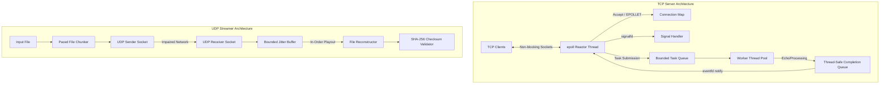
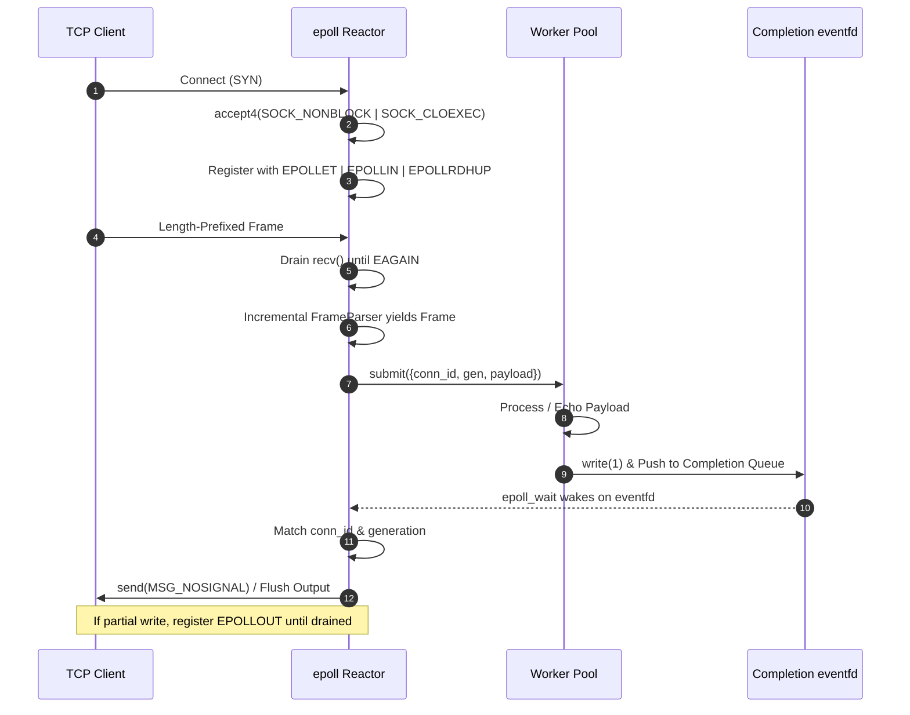
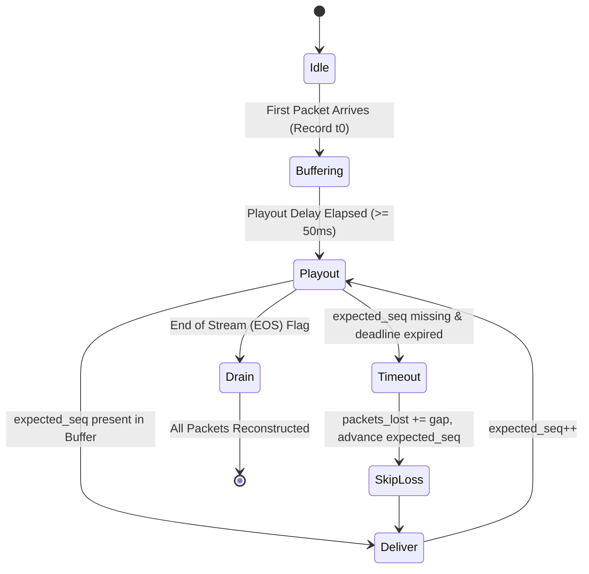

# NetStream Architecture Documentation

This document describes the design, concurrency model, subsystem boundaries, and state machines of **NetStream**, a high-performance multithreaded networking server and UDP media streamer built in C++17 on Linux.

---

## 1. High-Level Architecture

NetStream contains two decoupled primary subsystems:
1. **Event-Driven TCP Reactor & Worker Pool**: Non-blocking TCP server using Linux edge-triggered `epoll`, connection lifecycle generation tokens, and an asynchronous bounded worker pool communicating via `eventfd`.
2. **RTP-Style UDP Media Streamer & Jitter Buffer**: UDP file transport featuring microsecond pacing, 32-bit modular sequence numbering, bounded reordering jitter buffer, and cryptographic SHA-256 verification.

---

## 2. TCP Subsystem: Reactor & Concurrency Model

### 2.1 Concurrency & Ownership Rules
A core design constraint in robust systems engineering is avoiding lock contention across connection states.
- **Sole Reactor Ownership**: All client file descriptors, input buffers, output buffers, and socket mutation operations are owned strictly by the single-threaded `epoll` reactor.
- **Offloaded Computation**: Worker threads never read from or write directly to client sockets. Workers only receive self-contained request payloads.
- **Safe Response Return**: When a worker finishes processing, it pushes a `WorkerResponse` record to a thread-safe completion queue and writes an 8-byte scalar to an `eventfd`.
- **eventfd Wakeup**: The reactor wakes from `epoll_wait()`, grabs all pending responses under a single quick mutex lock, looks up the corresponding connection, updates the output buffer, and writes to the socket.

### 2.2 Connection Identification & Generation Tokens
When high volumes of clients connect and disconnect, the Linux kernel aggressively recycles low file descriptor numbers. Without safeguards, a delayed worker task could deliver a response to an old file descriptor that was just reassigned to an entirely new client.

To eliminate this vulnerability:
1. Every connection receives a globally unique, monotonically increasing 64-bit `conn_id`.
2. Every connection maintains a 32-bit `generation` token.
3. Every worker task captures `{conn_id, generation}`.
4. When delivering the completion, the reactor checks both `conn_id` existence and `current_conn.generation == resp.generation`. If mismatched, the stale response is safely discarded.

### 2.3 Edge-Triggered epoll (EPOLLET) Mechanics
- **Accept Draining**: When `EPOLLIN` fires on the listening socket, `accept4()` is called in a loop until it returns `EAGAIN` or `EWOULDBLOCK`.
- **Read Draining**: When `EPOLLIN` fires on a client socket, `recv()` drains the socket buffer into the parser until `EAGAIN`.
- **Write Draining**: When pending responses cannot be fully flushed in one `send()`, `EPOLLOUT` is dynamically enabled. Once all pending bytes are written, `EPOLLOUT` is immediately deregistered using `epoll_ctl(EPOLL_CTL_MOD)` to avoid busy-spinning.

### 2.4 Graceful Shutdown via signalfd
Signals like `SIGINT` and `SIGTERM` are blocked on all threads using `pthread_sigmask()`. A dedicated `signalfd` descriptor is registered with `epoll`. When a signal arrives, the reactor wakes cleanly from `epoll_wait()`, receives a synchronous `signalfd_siginfo` struct, and performs an orderly teardown:
1. Deregisters the listening socket (no new connections accepted).
2. Drains or closes active connections.
3. Shuts down the thread pool and joins all worker threads.
4. RAII `UniqueFd` destructors guarantee zero descriptor leaks.

---

## 3. UDP Subsystem: Streamer & Jitter Buffer

### 3.1 UDP Transmission Pipeline
The UDP streamer splits arbitrarily large files into discrete packets limited to 1400 bytes to guarantee that IP packets do not exceed the standard 1500-byte Ethernet MTU, avoiding router-level fragmentation.

### 3.2 Jitter Buffer Ingestion & Ordering
- **Sequence Comparison**: Uses modular 32-bit arithmetic (`seq_lt(a, b)`: `static_cast<int32_t>(a - b) < 0`).
- **Duplicate Suppression**: Drops packets whose sequence number is already present in the buffer.
- **Late Packet Detection**: If a packet arrives whose sequence number is strictly less than `expected_seq_`, the playout window has already passed; it is recorded as late and discarded.
- **Deadline Timeout**: When the expected sequence is missing, the buffer does not stall indefinitely. If elapsed time exceeds `packet_timeout`, the gap is recorded as lost packets, and playout advances to the next available sequence.
- **Exact File Offsets**: Every packet carries a 64-bit `file_offset` so that even if packets arrive out of order or with gaps, bytes are written to their exact positions in the output file.
